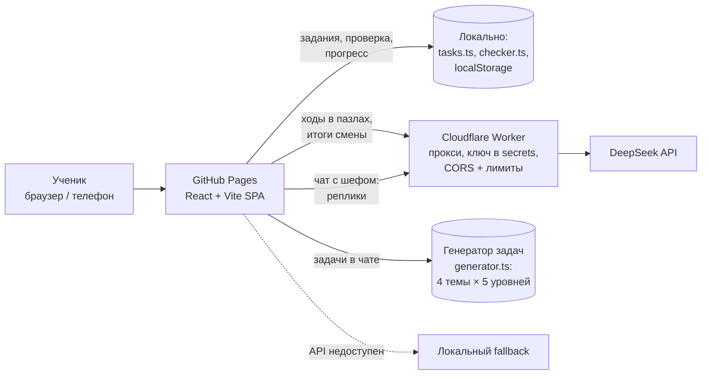

# 🍕 Пиццерия «Дробь» — тренажёр по дробям для 5–6 класса

> 🚧 **В разработке.** Демо появится здесь: **https://inversion322.github.io/fraction-pizzeria/**

Ученик подрабатывает в пиццерии у шефа Тоши и выполняет заказы клиентов: «половина + треть пиццы», «отрежь 3/8», «сколько осталось от полутора пицц?». Чтобы выполнить заказ, приходится резать пиццу, сравнивать куски, складывать и вычитать дроби. На каждый ответ ученик получает разбор: что не так и **почему**. В конце смены ИИ-шеф по ошибкам определяет типичное заблуждение ученика о дробях и советует, что повторить.

## Для кого и чему учит

| | |
|---|---|
| **Аудитория** | школьники 5–6 класса (10–12 лет) |
| **Тема** | обыкновенные дроби |
| **Навыки** | что такое дробь · сравнение дробей · равные дроби и сокращение · сложение и вычитание с разными знаменателями · смешанные числа · умение объяснить решение словами |
| **Объём** | 12 заказов · 3 уровня · около 15 минут |

## Как это работает

1. **Выполняй заказы.** Задания разных типов: выбрать ответ, разрезать пиццу и отметить куски тапами, ввести дробь (пицца рисует её в реальном времени). Каждый уровень заканчивается **пазлом по своей теме**: выстроить куски по размеру, собрать целую пиццу, разложить равные дроби по коробкам.
2. **Разбирай ошибки.** Неверный ответ не просто помечается «неверно»: тренажёр распознаёт, *какую именно* ошибку допустил ученик. Например, ответ `1/2 + 1/3 = 2/5` означает «складываю числители и знаменатели», и ученик получает объяснение именно этой ошибки. Со второй попытки показывается решение по шагам прямо на пицце.
3. **Получи разбор от ИИ-шефа.** После каждого пазла ИИ-агент смотрит на ходы ученика и пишет короткий разбор, а в конце смены составляет персональный отчёт: главное заблуждение, что получается хорошо, что потренировать, что делать дальше.
4. **Почувствуй прогресс.** Полоса прогресса показывает, сколько осталось до конца уровня, а в конце уровня — интерактивный салют.
5. **Тренируйся в чате с шефом.** После всей смены открывается вкладка «Чат с шефом»: ИИ-шеф даёт задачи на слабые места ученика — каждый раз новые и всё сложнее (5 уровней в каждой теме), объясняет ошибки и отвечает на вопросы. Потом можно пройти смену заново: чат подхватит новый результат и сравнит его с прошлым.

## Ключевые решения

- **Задачи в чате генерирует код, а разговаривает ИИ.** Языковая модель может ошибиться в арифметике, а в тренажёре по математике это недопустимо. Генератор создаёт задачу со случайными числами и точно проверяет ответ; ИИ-шеф подбадривает, подсказывает (не раскрывая ответ), объясняет ошибки и отвечает на вопросы. Корректность генератора проверяет `npm run check:tutor` — 6000 задач за запуск.

- **Мгновенная проверка локально, ИИ — там, где он действительно нужен.** Обычные задания проверяются в браузере: быстро, бесплатно и без зависимости от сети. ИИ разбирает ход решения пазлов и делает итоговую диагностику, то есть то, что не умеет обычная викторина.
- **Тренажёр работает и без ИИ.** Если API недоступен, включается локальный fallback: разбор пазла по записанным ходам и отчёт по статистике ошибок. Ученик не видит сломанного интерфейса.
- **Диагностика заблуждений, а не только подсчёт баллов.** Неверные ответы привязаны к каталогу из 5 типичных ошибок, которые часто встречаются у школьников при работе с дробями.
- **Ключ API не попадает в браузер.** Фронтенд размещён на GitHub Pages и обращается к ИИ через прокси на Cloudflare Workers, где ключ хранится в secrets.
- **Сначала телефон.** Куски пиццы выбираются тапами, без drag-and-drop. Зоны нажатия не меньше 44 px, интерфейс работает от ширины 360 px.

Подробнее: [docs/DECISIONS.md](docs/DECISIONS.md).

## Архитектура



## Стек

- **Фронтенд:** React, Vite, TypeScript, Tailwind CSS, Framer Motion, пицца в SVG
- **Шрифты:** Unbounded (заголовки, дроби) и Nunito (текст), с кириллицей, раздаются с самого сайта
- **ИИ:** DeepSeek API через Cloudflare Worker
- **Хостинг:** GitHub Pages (деплой через GitHub Actions)

## Запуск локально

```bash
npm install
npm run dev
```

Без переменной `VITE_AI_ENDPOINT` тренажёр работает на локальном fallback. Чтобы подключить ИИ, скопируйте `.env.example` в `.env` и укажите адрес прокси.

Проверки без браузера:

```bash
npm run check:tutor   # 6000 сгенерированных задач: ответы корректны и принимаются
npm run check:worker  # прокси против подменённого DeepSeek: CORS, валидация, лимиты, утечка ответа
```

## ИИ-прокси (Cloudflare Worker + DeepSeek)

Папка [`worker/`](worker/): тонкий прокси между сайтом и DeepSeek API. Ключ хранится только в секретах Cloudflare.

- **Маршруты:** `POST /chat` (реплики шефа в чате), `POST /puzzle` (разбор пазла), `POST /report` (отчёт смены).
- **Модель:** `deepseek-flash` в режиме JSON, без «размышлений» — короткие быстрые ответы.
- **Защита:** CORS только для сайта и localhost, лимит 40 запросов в минуту с IP, ограничение размера, проверка входа и формы ответа модели. Пока ученик решает задачу, прокси не пропустит реплику, в которой назван ответ, — вместо неё уйдёт проверенная локальная реплика.
- **Отказоустойчивость:** при любой ошибке (нет баланса, перегрузка, пустой ответ) сайт молча переключается на локальные тексты.

Развёртывание:

```bash
cd worker
npx wrangler login                       # вход в Cloudflare через браузер
npx wrangler secret put DEEPSEEK_API_KEY # вставить ключ DeepSeek
npx wrangler deploy                      # выдаст адрес https://fraction-pizzeria-ai.<аккаунт>.workers.dev
```

Адрес воркера указывается в `VITE_AI_ENDPOINT` при сборке сайта.

## Как делался проект

Проект собран с помощью нейросетей, по процессу «спецификация → генерация → доработка → проверка»:

1. **Claude Code**: разбор ТЗ, выбор темы и механики, проектирование заданий и каталога ошибок, написание спецификации для генерации интерфейса ([docs/manus-prompt.md](docs/manus-prompt.md)).
2. **Manus**: генерация первой версии интерфейса по спецификации (коммит «Import UI generated by Manus»).
3. **Claude Code + скиллы [ui-ux-pro-max](https://github.com/nextlevelbuilder/ui-ux-pro-max-skill) и [impeccable](https://github.com/pbakaus/impeccable)**: редизайн и чистка «ИИ-шаблонности» — подробнее в [docs/DECISIONS.md](docs/DECISIONS.md#8-дизайн-редизайн-первой-версии).
4. **Claude Code**: подключение ИИ-бэкенда, исправление ошибок, проверка на телефоне и десктопе, деплой.

## Статус

- [x] Тема, механика, 12 заданий, каталог ошибок
- [x] Спецификация интерфейса
- [x] Интерфейс (Manus) и редизайн
- [x] ИИ-прокси (Cloudflare Worker + DeepSeek), проверен на подменённом API
- [ ] Развёртывание прокси (нужен вход в Cloudflare и ключ DeepSeek)
- [ ] Проверка на мобильных и десктопе
- [ ] Деплой на GitHub Pages
