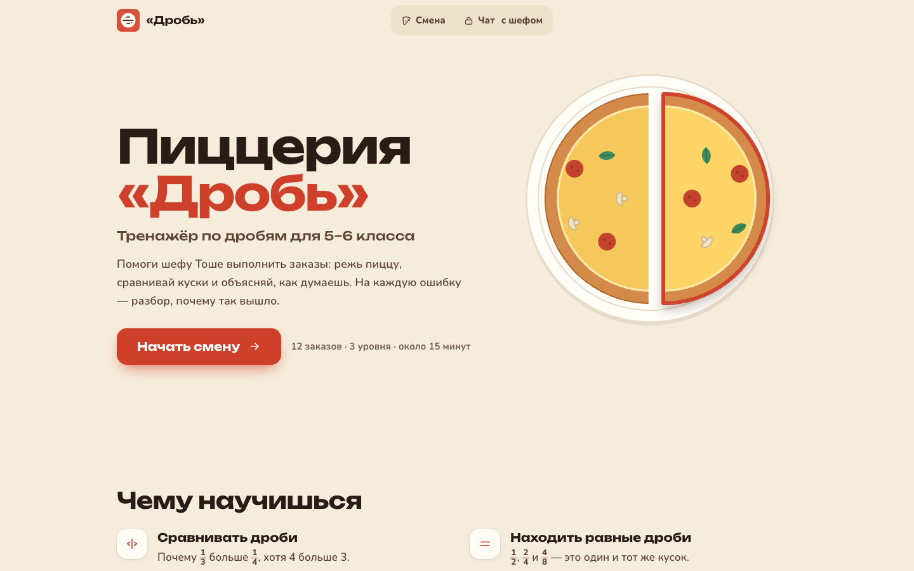
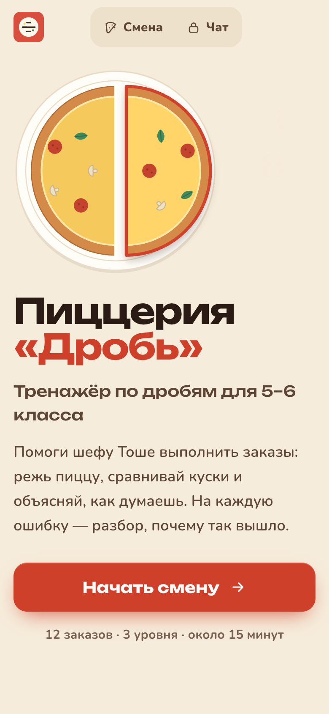
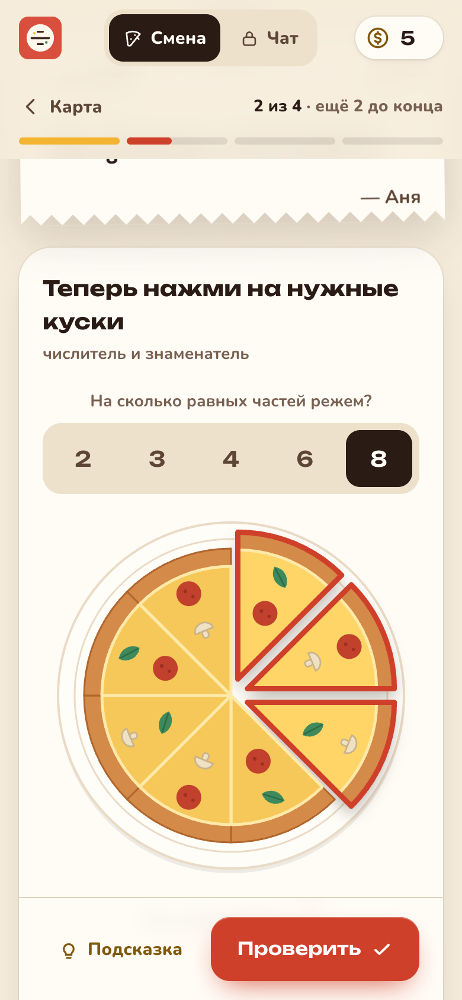
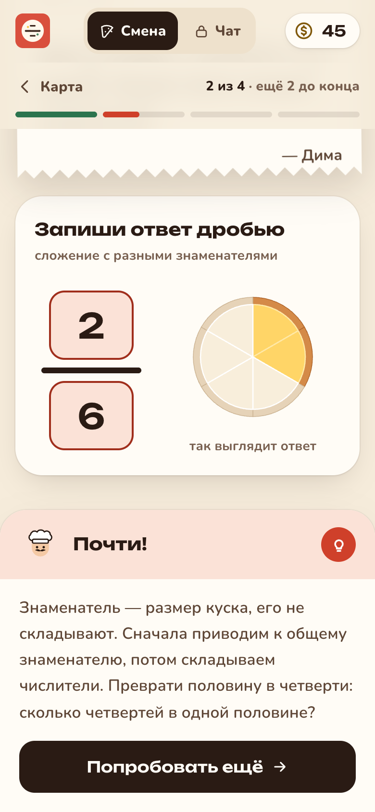
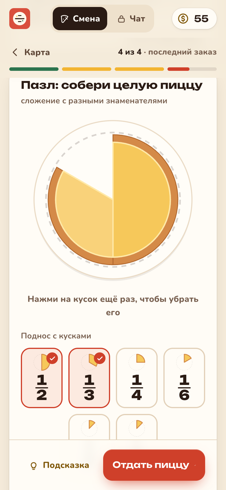
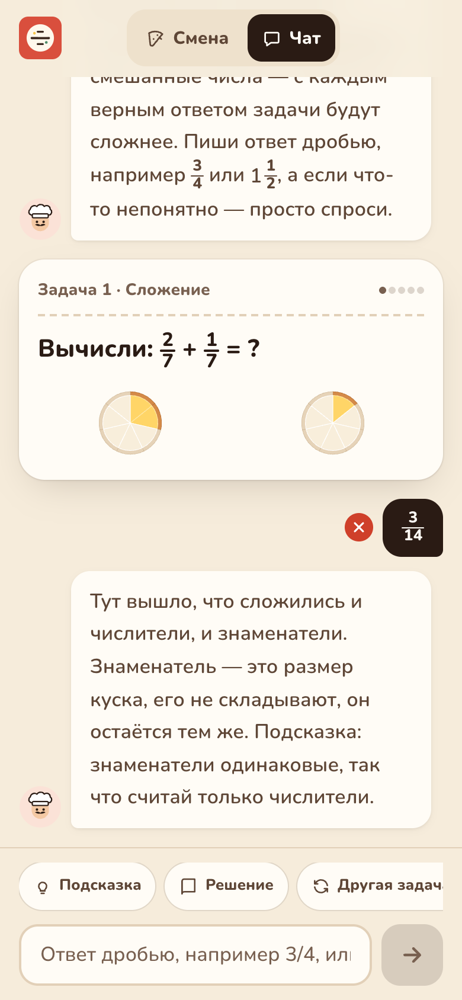
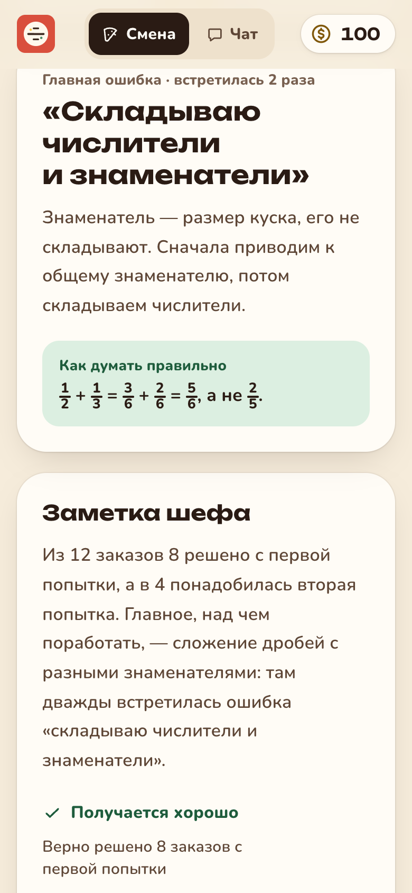
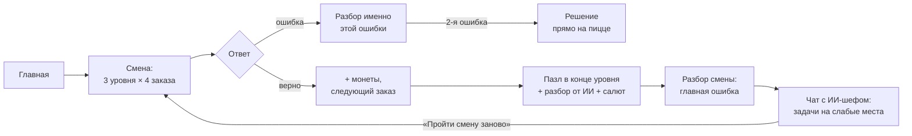
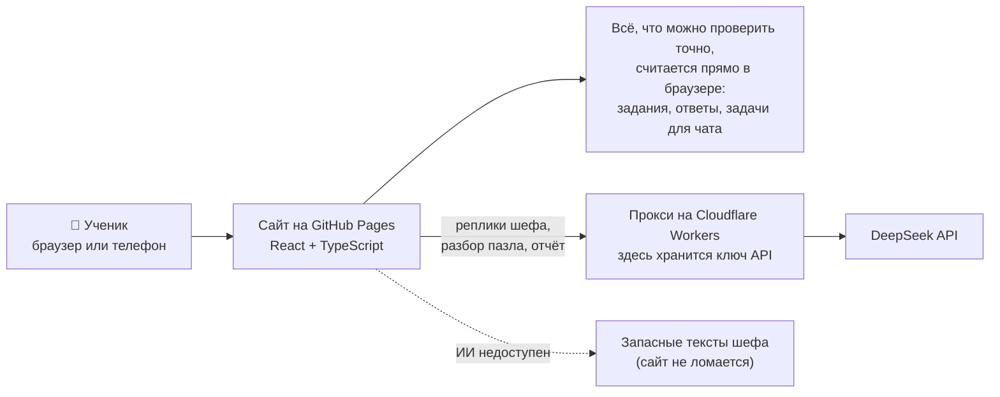

<div align="center">

# 🍕 Пиццерия «Дробь»

**Тренажёр по дробям для 5–6 класса, где ученик работает в пиццерии, а ИИ-шеф разбирает его ошибки**

[**Открыть сайт →**](https://inversion322.github.io/fraction-pizzeria/)

[](https://github.com/inversion322/fraction-pizzeria/actions/workflows/deploy.yml)




</div>

---

## Коротко о проекте

**Для кого.** Ученики 5–6 класса (10–12 лет). Тема — обыкновенные дроби, на которой многие начинают отставать по математике.

**Идея.** Пицца, нарезанная на равные куски, — это и есть наглядная модель дроби. Ученик подрабатывает у шефа Тоши: режет пиццу, выдаёт куски, считает заказы. Дробь не заучивается, а *видна*.

**Чем отличается от обычной викторины.**

- 🎯 **Понимает, *какая* ошибка.** Ответ «1/2 + 1/3 = 2/5» — не просто «неверно»: тренажёр видит, что сложены знаменатели, и объясняет именно это.
- 🧩 **Каждый уровень заканчивается пазлом** по своей теме — выстроить куски по размеру, собрать целую пиццу, разложить равные дроби по коробкам.
- 👨‍🍳 **ИИ-шеф** разбирает ход решения пазла, пишет итоговый отчёт и ведёт чат-тренировку на слабых местах ученика — с задачами, которые каждый раз новые и всё сложнее.
- 📱 **Удобно с телефона** — всё нажимается пальцем, кнопки крупные, ничего не уезжает за экран.

## Как это выглядит

<table>
  <tr>
    <td align="center" width="25%"><br><sub><b>Главная.</b> Пицца сама перенарезается: ½ → ⅓ → ¾ → ⅜</sub></td>
    <td align="center" width="25%"><br><sub><b>Задание.</b> Нарезать на 8 частей и выдать 3/8. Сверху — прогресс уровня</sub></td>
    <td align="center" width="25%"><br><sub><b>Разбор ошибки.</b> 1/2 + 1/4 ≠ 2/6 — шеф объясняет почему</sub></td>
    <td align="center" width="25%"><br><sub><b>Пазл уровня.</b> Собрать ровно одну пиццу из кусков</sub></td>
  </tr>
  <tr>
    <td align="center" colspan="2"><br><sub><b>Чат с шефом.</b> Ответ 3/14 — ИИ узнал ошибку и подсказал, не выдав ответ</sub></td>
    <td align="center" colspan="2"><br><sub><b>Разбор смены.</b> Главная ошибка ученика и заметка ИИ-шефа</sub></td>
  </tr>
</table>

## Путь ученика



| Уровень | Чему учит | Пазл в конце |
|---|---|---|
| 1. Первые куски | что такое дробь, какой кусок больше, равные дроби | выдать куски от меньшего к большему |
| 2. Собери заказ | сложение и вычитание с разными знаменателями | собрать ровно одну целую пиццу |
| 3. Час пик | сокращение, смешанные числа, задачи с несколькими гостями | разложить равные дроби по коробкам |

## Как это устроено



Три принципа, на которых всё держится:

1. **Математику считает код, а разговаривает ИИ.** Языковая модель может ошибиться в арифметике — для тренажёра это недопустимо. Поэтому задания проверяет код, задачи для чата генерирует код (с точным ответом), а ИИ отвечает за «человеческую» часть: подбодрить, подсказать, объяснить ошибку своими словами, ответить на вопрос ученика.
2. **Сайт работает и без ИИ.** Если DeepSeek недоступен или закончился баланс, ученик видит заранее подготовленные реплики шефа — ничего не ломается и не зависает.
3. **Ключ API не попадает в браузер.** Сайт — это просто файлы на GitHub Pages, там нельзя хранить секреты. Поэтому между сайтом и DeepSeek стоит маленький прокси на Cloudflare: он хранит ключ, пускает запросы только с сайта, ограничивает их частоту и проверяет, что ответил ИИ.

<details>
<summary><b>Как работает чат с шефом — подробнее</b></summary>

<br>

- После смены движок считает, в каких темах были ошибки (сравнение, равные дроби, сложение, смешанные числа), и начинает с самых слабых.
- **Генератор** создаёт задачу со случайными числами — каждый раз новую. В каждой теме 5 уровней: например, сравнение растёт от «1/5 или 1/4?» до «7/9 или 7/8?», сложение — от «7/9 + 1/9» до «1/2 + 2/3 + 3/4».
- Верный ответ поднимает уровень темы, две ошибки подряд — шеф показывает решение, и следующая задача будет проще.
- Ответ принимается в любой естественной записи: «3/4», «3 / 4», «1 1/2», «1 целая 1/2».
- Для типичных ошибок заложены «ловушки»: ответ 4/10 на «1/5 + 3/5» распознаётся как сложение знаменателей.
- **ИИ** получает задачу, ответ ученика и готовую реплику шефа и переписывает её живее. Пока ученик решает, прокси не пропустит реплику, где назван ответ.
- После новой смены чат начинается заново и сравнивает результат с прошлым: «было 8 из 12, стало 11 — плюс 3».

</details>

## Структура кода

```
fraction-pizzeria/
├── src/                        ← сайт (React + TypeScript)
│   ├── App.tsx                 ← экраны и переходы между ними, монеты, вкладки «Смена / Чат»
│   ├── screens/                ← экраны: главная, карта уровней, задание, итог уровня, разбор, чат
│   ├── components/             ← детали интерфейса
│   │   ├── Pizza.tsx           ← пицца в SVG: нарезка, выбор кусков, анимации
│   │   ├── Frac.tsx            ← дроби «столбиком», как в учебнике
│   │   ├── puzzles/            ← три пазла уровней
│   │   ├── LevelProgress.tsx   ← полоса прогресса уровня
│   │   └── Fireworks.tsx       ← салют в конце уровня (canvas)
│   ├── data/                   ← содержание: 12 заданий и каталог типичных ошибок
│   └── lib/                    ← логика без интерфейса
│       ├── checker.ts          ← проверка ответа и распознавание ошибки
│       ├── fractions.ts        ← арифметика дробей
│       ├── ai.ts               ← единственная точка обращения к ИИ (+ запасные тексты)
│       └── tutor/              ← чат с шефом: генератор задач, движок, состояние переписки
├── worker/                     ← прокси для DeepSeek (Cloudflare Worker)
│   ├── src/index.ts            ← маршруты /chat, /puzzle, /report, защита и проверки
│   └── src/prompts.ts          ← инструкции для ИИ-шефа
├── scripts/                    ← автоматические проверки и снятие скриншотов
├── docs/                       ← журнал решений и исходное ТЗ для генерации интерфейса
└── .github/workflows/          ← проверки и публикация на GitHub Pages
```

## Качество и проверки

| Что проверяется | Как |
|---|---|
| Генератор задач для чата | `npm run check:tutor` — 6000 задач: ответ корректен, верный ответ всегда принимается, «ловушки» не совпадают с ответом |
| Прокси для ИИ | `npm run check:worker` — 19 сценариев против подменённого DeepSeek: чужие сайты, кривые запросы, лимиты, пустой ответ ИИ, утечка ответа, служебные коды |
| Публикация | GitHub Actions перед каждой публикацией прогоняет обе проверки и сборку |
| Живой ИИ | вручную: реплики шефа, разбор пазла, отчёт, попытка заставить шефа назвать ответ |
| Интерфейс | телефон 375 px и десктоп 1280–1440 px; управление с клавиатуры; уважение к настройке «уменьшить движение»; контраст текста по WCAG AA |

## Запуск у себя

```bash
npm install
npm run dev          # http://localhost:5173 — работает и без ИИ, на запасных текстах
```

Чтобы подключить ИИ, укажите адрес прокси в `.env` (см. `.env.example`). Развёртывание своего прокси:

```bash
cd worker
npx wrangler login                        # вход в Cloudflare
npx wrangler secret put DEEPSEEK_API_KEY  # ключ DeepSeek хранится только в Cloudflare
npx wrangler deploy
```

## Как делался проект

Проект собран с помощью нейросетей по схеме «спецификация → генерация → доработка → проверка»:

1. **Claude Code** — разбор ТЗ, выбор темы и механики, 12 заданий и каталог типичных ошибок, спецификация интерфейса ([docs/manus-prompt.md](docs/manus-prompt.md)).
2. **Manus** — первая версия интерфейса по спецификации ([коммит](https://github.com/inversion322/fraction-pizzeria/commit/d22eac1)).
3. **Claude Code + скиллы [ui-ux-pro-max](https://github.com/nextlevelbuilder/ui-ux-pro-max-skill) и [impeccable](https://github.com/pbakaus/impeccable)** — редизайн и чистка «ИИ-шаблонности», пазлы, прогресс, салют, чат с шефом.
4. **Claude Code** — прокси для DeepSeek, автоматические проверки, публикация, проверка на живом ИИ.

Почему принято то или иное решение — в [журнале решений](docs/DECISIONS.md).

## Что можно улучшить дальше

- Адаптивная практика ещё точнее: подбирать задачи не только по теме, но и по конкретной ошибке ученика.
- Новые темы: умножение и деление дробей, десятичные дроби.
- Озвучка заданий для тех, кому тяжело читать.
- Кабинет учителя: статистика класса по типичным ошибкам.

---

<sub>Учебный демопроект, выполненный как тестовое задание. Все персонажи и заказы вымышлены.</sub>
